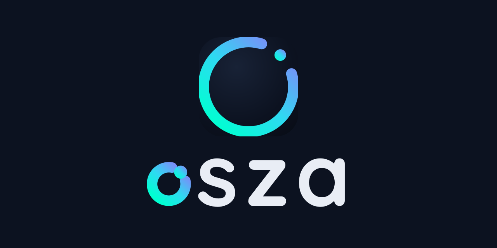

<p align="center">
  
</p>

<h1 align="center">Osza Browser</h1>

<p align="center">
  <strong>A fast, secure and privacy-focused web browser built with Qt.</strong><br/>
  Maintained by the <a href="https://github.com/osza-tools">Osza Tools</a> team.
</p>

---

## About

Osza Browser is a lightweight yet full-featured web browser powered by the
**QtWebEngine** rendering engine. It combines speed and privacy with a clean,
familiar interface, and it runs on **Linux, Windows and macOS**.

Osza Browser is a fork of [Falkon](https://www.falkon.org), deeply rebranded
and evolved as an independent project. We are grateful to the original Falkon
and KDE contributors for their work.

## Features

- **Speed** — a lightweight interface on top of the Chromium-based
  QtWebEngine rendering engine.
- **Privacy first** — built-in private browsing, per-site settings and
  full control over cookies, JavaScript and other permissions.
- **Security tools** — a bundled security suite: HTTPS-Only mode
  (upgrades every insecure connection, with per-site exceptions and
  shortcuts in the padlock menu), tracking-parameter stripping
  (utm_*, fbclid, gclid and friends are removed from links before
  they load), browser-fingerprint randomization (canvas, WebGL, audio
  and hardware readouts get deterministic per-site noise, so
  trackers cannot tie your browsing together; on by default, with a
  per-site opt-out in the padlock menu and a bulk-management dialog in
  Preferences), the Global Privacy Control
  signal (Sec-GPC: 1 is sent with every request and reported to page
  scripts - the legally-binding opt-out from the sale or sharing of
  personal data; on by default), DNS-over-HTTPS (encrypts all
  hostname resolution, with known providers or a custom server) and
  malicious-site protection (navigations to blocklisted hosts stop on
  a full-screen warning page with a session-scoped "proceed anyway";
  subresources of listed hosts are blocked; the warning page's "Why
  is this site flagged?" disclosure names the matching blocklist
  entry - the host itself, or the listed parent domain that covers
  it - together with the list's source, size and last update). The
  whole suite can be backed up and moved: the dashboard's
  "Import / Export" button (also in Preferences → Privacy → Security
  tools) saves the configuration of every protection - switches,
  exception lists, secure DNS servers, blocklist source - to one
  portable JSON file, and applies such a file to another machine or
  profile; exports carry a checksum of their contents, so a file that
  was changed or corrupted after the export is refused on import
  (with an explicit "import anyway" for deliberate hand edits, and
  `tools/security/verify_settings_porter.py --update-checksum` to
  re-seal an edited file). Imports are informed, not blind: before
  anything is applied, a preview dialog shows what the file would
  change - per tool and per field, the current value against the
  value after the import - plus what it leaves out and what it would
  skip, with the reason; a changed site-exception list comes with a
  one-line summary naming the sites that lose their exception and
  the sites that gain one, since those are the sites whose treatment
  actually changes. A checksum mismatch is called out in the
  same dialog and the confirmation becomes an explicit "import
  anyway". The same per-tool diff, exception summaries included, is
  available offline for hand edits, as
  `tools/security/verify_settings_porter.py --diff FILE
  [FILE-or-preset]`. For a quick start, the same places offer
  recommended-baseline presets - Essentials, Recommended baseline
  and Maximum protection - that apply a ready-made configuration of
  all seven tools through the same validation as an import, and the
  picker also saves any preset as a regular checksum-verified
  settings file, so a baseline can be shared without applying it
  first. Baselines can be judged before they are applied: the
  osza:settings-diff page (from the dashboard's baseline menu or the
  picker's "Preview..." button) shows what a baseline would change
  in this profile, tool by tool, computed live through the same
  preview the import dialog uses - exception summaries included -
  with the number of changes per baseline on the overview and the
  tools already at the baseline's settings named; the page is a
  preview only, applying stays a separate, confirmed step. Each
  tool's part of a baseline has its own address
  (osza:settings-diff?preset=…&tool=secureDns): every section of
  the diff carries a "#" link to exactly that URL, opening the page
  focused on the section - marked, scrolled to, and introduced by a
  note - and a tool the baseline would leave alone is answered by a
  note saying why (skipped with the reason, already matching, or
  not in the baseline). The security dashboard's protection rows
  link there too: every row's "diff" link, beside its quick switch,
  opens the recommended baseline's diff focused on that tool's
  section - the same per-tool address the page's "#" links use - so
  the row that shows a tool's state is one click from what the
  recommendation would change about it. The import preview dialog
  meets the page there: it stays window-modal while the decision is
  pending (so the profile it previews cannot change under it), and a
  file verifiably saved from a built-in preset - a known preset name
  plus a matching checksum - carries a "view as page" link that
  follows the selected tool's row and opens the diff as a page in
  a window of its own, readable beside the decision. A file
  saved from a preset still names the preset it came from, and the
  import preview says so - known presets by name, unknown ids
  verbatim. The per-profile fingerprint seed is deliberately never
  part of it. The
  security dashboard sidebar keeps live counters of blocked ads,
  stripped trackers, HTTPS upgrades and blocked threats, with quick
  switches for every protection - each switch's row carrying its
  "diff" link into the recommended baseline - and the built-in
  security self-test page (osza:selftest, one click from the
  sidebar) measures the
  browser's own canvas, WebGL, audio and hardware readouts live -
  through the same hooks a fingerprinting site would use - and
  verifies the randomization
  working, with the invisible per-site noise made visible. The
  per-site state is visible before any menu is opened: the
  location bar's site icon (and the popup windows' location bar)
  carries a small amber badge whenever the current site has a
  per-site exception - an HTTPS-Only exclusion, a fingerprint or
  GPC opt-out exclusion, or a threat-block "proceed anyway" paused
  for the session - and its tooltip names the relaxed protections;
  clicking the icon opens the padlock menu, where each tool's row
  states and changes the site's treatment. Everything
  lives in Preferences → Privacy → Security tools.
- **Ad blocking** — integrated AdBlock support with filter subscriptions.
- **Everything in its place** — bookmarks, history, downloads and RSS
  feeds, all reachable from collapsible sidebars.
- **Speed Dial** — your favorite sites one click away on the start page.
- **Sessions** — save and restore complete browsing sessions.
- **Themes** — flexible theming with bundled themes for every platform.
- **Extendable** — native C++/Qt plugins plus Python (PySide6) plugins.

## Downloads

The current release is [**Osza Browser 1.2**](https://github.com/osza-tools/osza-browser/releases/tag/v1.2),
the modern chrome refresh release:

| Platform | File | Notes |
|---|---|---|
| Linux x86_64 | `Osza-Browser-1.2-linux-x86_64.tar.gz` | Extract and run `usr/bin/osza` (plain `/usr` layout). |
| Linux (Snap) | `osza-browser_1.2_amd64.snap` | `sudo snap install ./osza-browser_1.2_amd64.snap --dangerous` |
| macOS (Apple Silicon) | `Osza-Browser-1.2-macos-arm64.dmg` | Drag **Osza** to Applications. Not notarized — right-click → Open on first launch. |
| Windows x64 | `Osza-Browser-1.2-windows-x64.zip` | Extract and run `osza.exe` (MSVC 2022, Qt 6.8 LTS). |

For older releases and checksums see the
[releases page](https://github.com/osza-tools/osza-browser/releases),
or [build from source](#building).

## Building

### Requirements

- Qt >= 6.4 (with QtWebEngine, WebChannel, Sql, Network, Widgets, QuickWidgets, PrintSupport, DBus)
- KF6 Archive (required), ECM (Extra CMake Modules)
- OpenSSL
- Optional: KF6 Wallet / KIO / Crash / CoreAddons / Purpose (enables the *System Integration* plugin),
  PySide6 + Shiboken6 (enables Python plugins)

### Linux / macOS

```sh
mkdir build && cd build
cmake .. -DCMAKE_BUILD_TYPE=Release
make -j$(nproc)
make install
```

### Install to a custom prefix

When installing Osza Browser to a custom prefix, you may need to adjust the
`XDG_DATA_DIRS` environment variable:

```sh
# Build
cmake -DCMAKE_INSTALL_PREFIX=$HOME/osza

# Run
export XDG_DATA_DIRS="$HOME/osza/share:$XDG_DATA_DIRS"
$HOME/osza/bin/osza
```

## Contributing

Want to contribute? Great!

- Open an [issue](https://github.com/osza-tools/osza-browser/issues) for bugs
  and feature requests.
- Send pull requests against the `main` branch — keep changes focused and
  describe the *why* in the commit message.

## License

Osza Browser is free software licensed under the
**GNU General Public License version 3 or (at your option) any later version**
(see [COPYING](COPYING)).

It is based on Falkon — Copyright (C) David Rosca, Juraj Oravec and Falkon/KDE
contributors.
